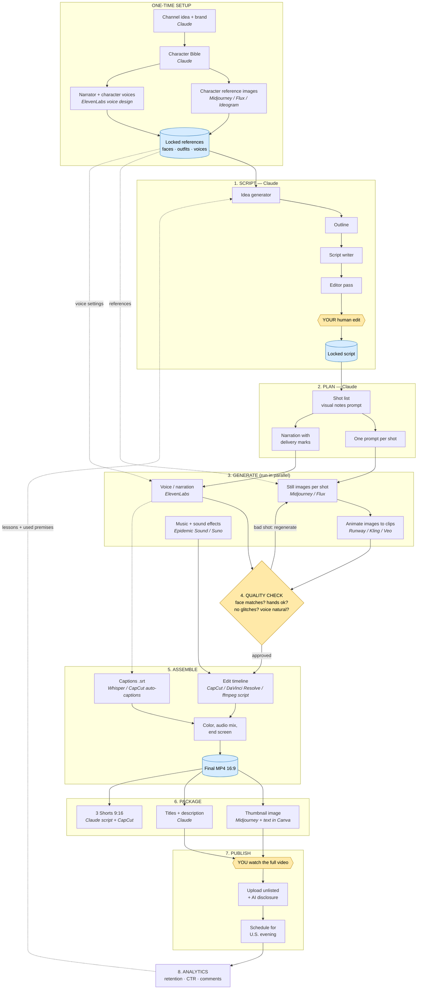

# 00 — AI Workflow Diagram

How each part of a video is made with AI, from idea to upload. Open this file with Markdown Preview (or view it on GitHub) to see the diagram drawn.

Tool names are examples; pick one per box and check its commercial-use terms.



**Legend:** yellow = a human (you) must decide · blue = a saved, locked output · dotted lines = reused inputs or feedback.

## Same flow in plain text

```text
ONE-TIME SETUP
  Channel idea ─► Character Bible ─┬─► Reference images (image AI) ─┐
                                   └─► Voices (voice AI) ───────────┴─► LOCKED REFERENCES
                                                                              │
EVERY EPISODE                                                                 ▼
  1 SCRIPT    Claude: idea ─► outline ─► script ─► editor ─► YOUR EDIT ─► LOCKED SCRIPT
                                                                              │
  2 PLAN      Claude: shot list + one prompt per shot + narration marks       │
                                                                              ▼
  3 GENERATE  ┌─ Voice AI ─────────── narration.mp3
              ├─ Image AI ─► Video AI ─ shot clips  (uses locked references)
              └─ Music/SFX library ─── music + sound
                                                                              │
  4 QC        Bad shot? ──► regenerate ◄──┐   Good? ──► continue              │
                                                                              ▼
  5 ASSEMBLE  Editor (CapCut / DaVinci / ffmpeg) + captions ─► FINAL MP4
  6 PACKAGE   Thumbnail · titles · description · 3 Shorts
  7 PUBLISH   YOU watch it ─► upload unlisted + AI disclosure ─► schedule
  8 ANALYTICS Retention, CTR, comments ─► feed back into step 1
```

## Where each AI is used

| Job | AI type | Example tools | Prompt file |
|---|---|---|---|
| Ideas, outline, script, edits | Text AI | Claude | [prompts/script/](../prompts/script/) |
| Shot list and shot prompts | Text AI | Claude | [05-visual-notes](../prompts/script/05-visual-notes.md) |
| Character and location images | Image AI | Midjourney, Flux, Ideogram | [character](../prompts/character-reference-sheet.md) · [location](../prompts/location-reference.md) |
| Moving clips | Video AI (image-to-video) | Runway, Kling, Veo | [video-shot](../prompts/video-shot.md) |
| Narration and dialogue | Voice AI | ElevenLabs | [voice-sample](../prompts/voice-sample.md) · [narration-direction](../prompts/narration-direction.md) |
| Music and SFX | Music library / music AI | Epidemic Sound, Suno | — |
| Captions | Speech-to-text | Whisper, CapCut auto-captions | — |
| Editing | Editor (some AI features) | CapCut, DaVinci Resolve, ffmpeg | — |
| Thumbnail | Image AI + design tool | Midjourney + Canva | [thumbnail](../prompts/thumbnail.md) |
| Titles and description | Text AI | Claude | [title-and-description](../prompts/title-and-description.md) |
